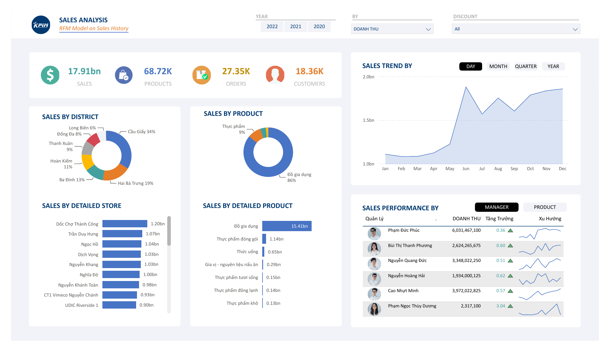
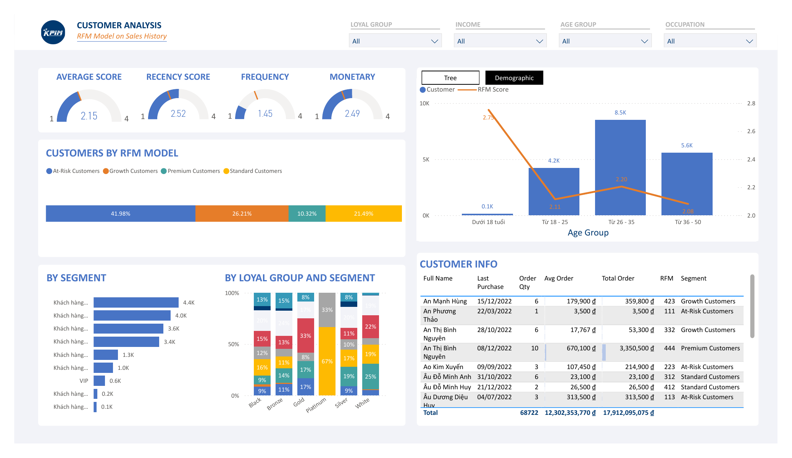
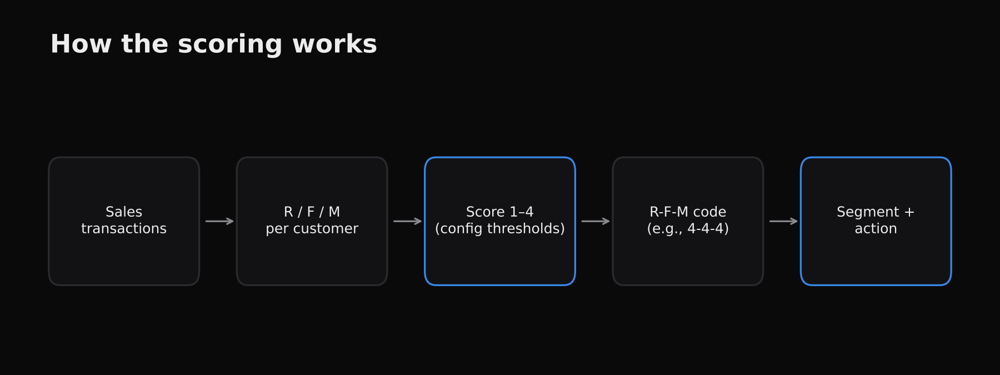
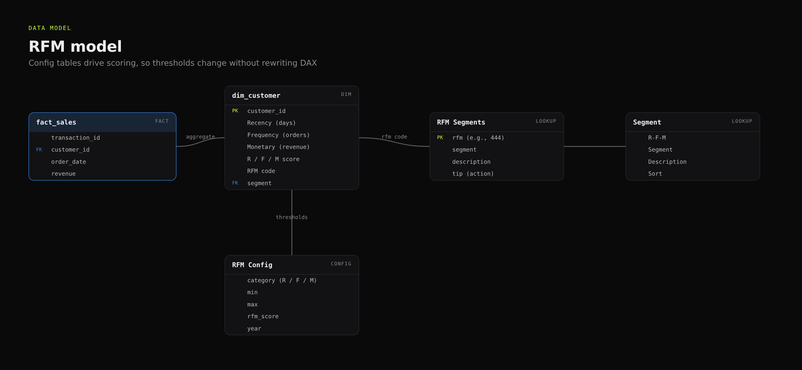
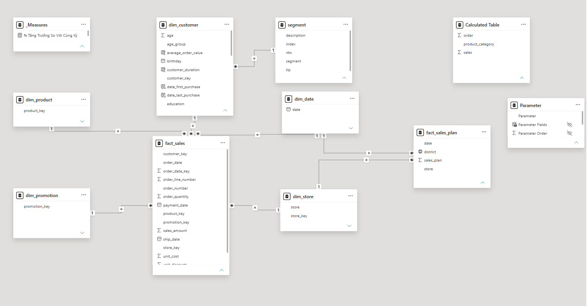
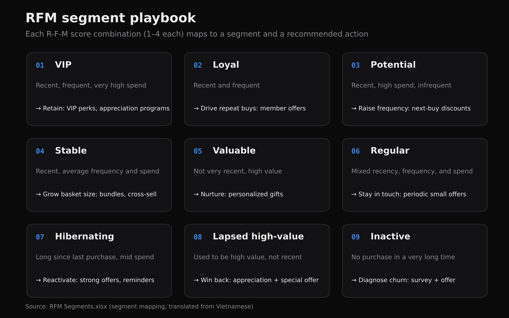

# RFM Customer Segmentation (Power BI)

## Introduction
Not every customer is worth the same marketing effort. This project segments customers with the classic **RFM** model (**R**ecency, **F**requency, **M**onetary value) and turns each segment into a concrete action, such as rewarding VIPs or re-engaging customers at risk of churning. It also tracks revenue against the monthly plan.

## How it works
1. **Score:** DAX calculated columns on `dim_customer` compute each customer's recency, frequency, and monetary value and turn each into a 1–4 score.
2. **Segment:** the R-F-M code (for example, 4-4-4) links to the `segment` table, which names the segment, such as *VIP* or *Loyal*.
3. **Act:** each segment carries a description and a recommended marketing action.
4. **Track:** actual revenue is compared against the monthly revenue plan.

## Report pages
1. **Sales analysis:** KPI cards (sales, products, orders, customers); sales by district, product, and store; sales trend by day, month, quarter, or year; sales performance by manager or product
2. **Customer analysis:** average recency, frequency, and monetary scores; customers by RFM group; customers by segment and by loyalty group; customers and RFM score by age group; a customer table with each customer's RFM code and segment

## Files
| File | Description |
|---|---|
| `Capstone Project.pbix` | Power BI report |
| `RFM Segments.xlsx` | R-F-M code → segment, description, and recommended action (the `segment` table in the model) |
| `Segment.xlsx` / `Segment.csv` | Segment labels and display order |
| `PowerBiCoBan_..._Kế hoạch doanh thu.xlsx` | Monthly revenue plan |

## Skills demonstrated
Customer analytics · RFM scoring with DAX calculated columns · data modeling · Power Query · turning analysis into business actions

## Gallery

_Diagrams are editable in draw.io: [`docs/diagrams/`](docs/diagrams)._

**How the RFM scoring works**

**Data model: DAX-scored customers mapped to the segment table**

**Power BI Model view (from Power BI Desktop)**

**Segment playbook: who to target and how**

